<p align="center">
  
</p>

<p align="center">
  <strong>Self-hosted e-commerce system built with Symfony</strong><br>
  Catalog, cart, checkout, payments, invoices and a full back office – on your own server.
</p>

<p align="center">
  
  
  
  
  
  
</p>

<p align="center">
  <a href="https://symfoshop.jeremythelen.de/"><strong>Live demo</strong></a> ·
  <a href="#features">Features</a> ·
  <a href="#screenshots">Screenshots</a> ·
  <a href="#quick-start">Quick start</a> ·
  <a href="#deployment">Deployment</a> ·
  <a href="#architecture">Architecture</a>
</p>

<p align="center">
  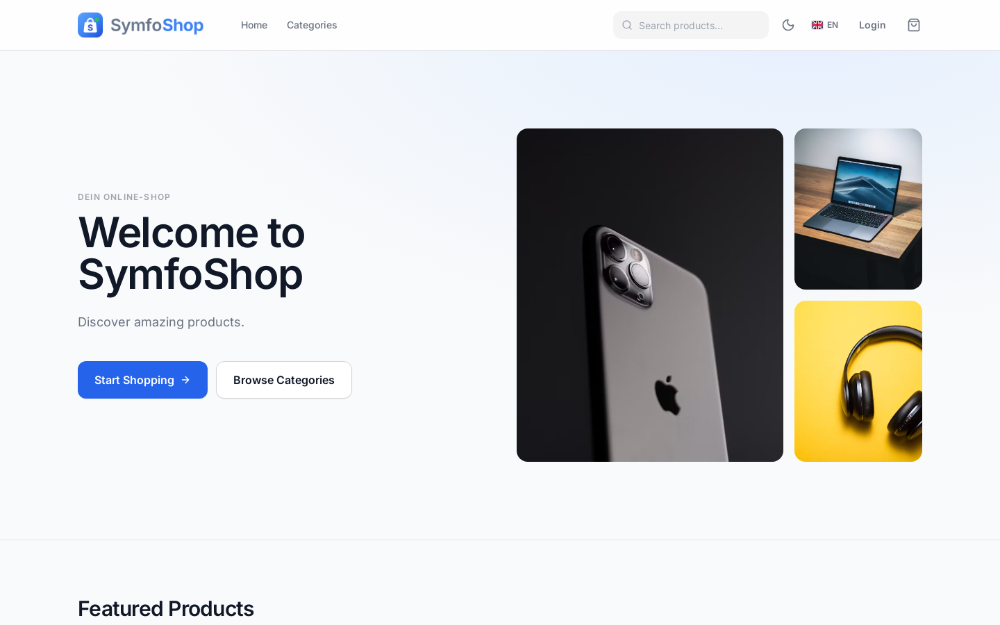
</p>

## Overview

SymfoShop is a production-oriented shop system that operators install and run on their own server – with Docker Compose or classically with PHP and MySQL. It covers the whole order lifecycle: catalog with variants, cart and coupons, checkout with shipping and country-based VAT, payments via Stripe and PayPal, PDF invoices, returns, customer support and a back office with roles for admin, support and warehouse. Storefront and admin are available in English, German and French.

> **Try it:** open the [live demo](https://symfoshop.jeremythelen.de/) and use the [login page](https://symfoshop.jeremythelen.de/login) to sign in with one click as **admin** or **customer** – no password needed. Only the test bank is enabled as payment method, no real emails are sent, and all demo data is reset every hour.

## Screenshots

<table>
  <tr>
    <td width="50%">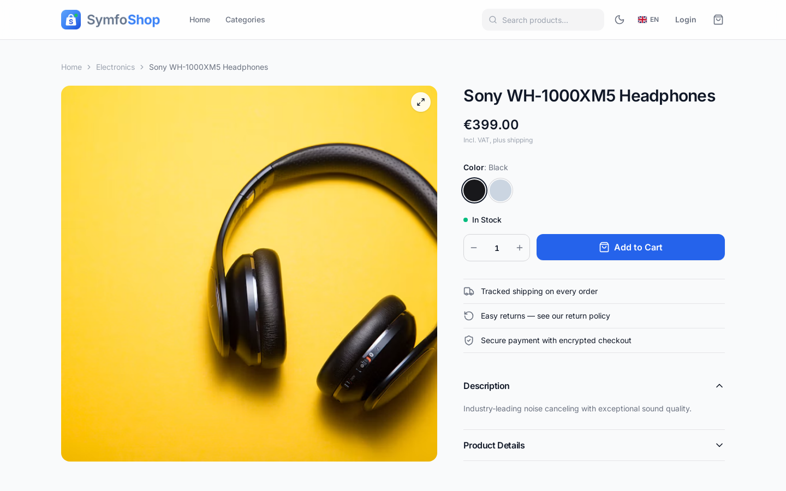<br><sub><b>Product page</b> – variants, stock status, add to cart</sub></td>
    <td width="50%">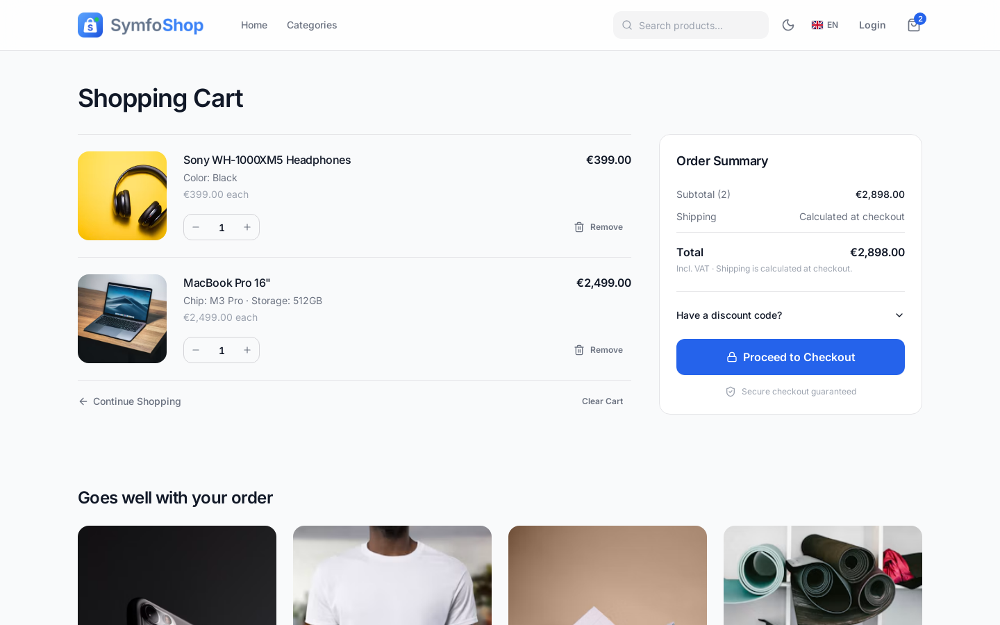<br><sub><b>Cart</b> – coupons, order summary, recommendations</sub></td>
  </tr>
  <tr>
    <td width="50%">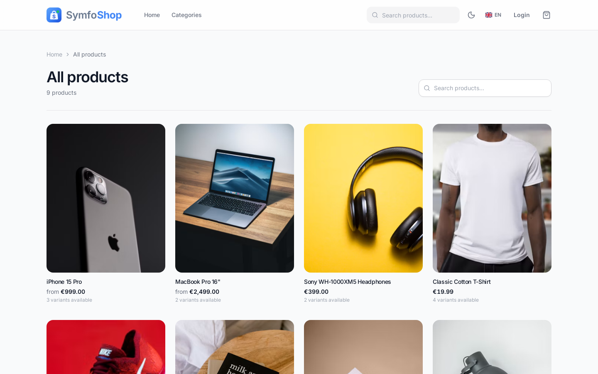<br><sub><b>Catalog</b> – categories and product search</sub></td>
    <td width="50%">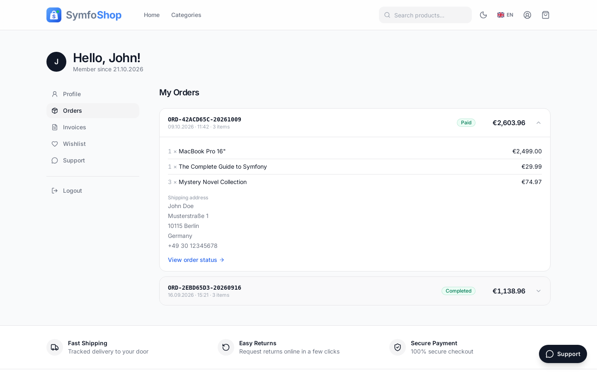<br><sub><b>Customer account</b> – orders, invoices, wishlist, support</sub></td>
  </tr>
  <tr>
    <td width="50%">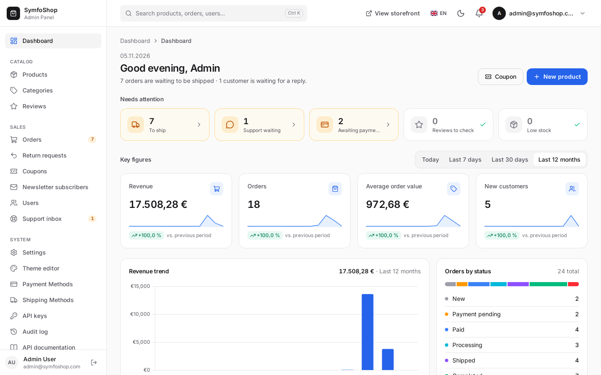<br><sub><b>Admin dashboard</b> – what needs attention, key figures, trends</sub></td>
    <td width="50%">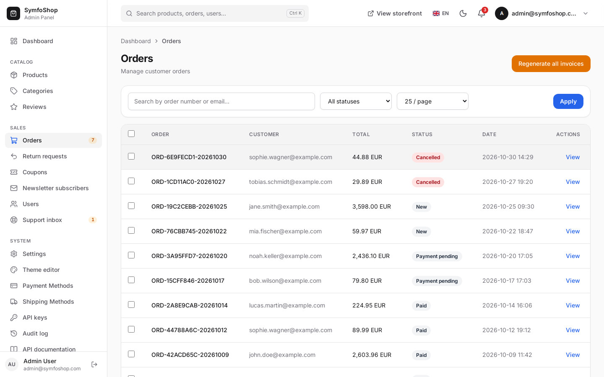<br><sub><b>Orders</b> – search, status filter, bulk invoice actions</sub></td>
  </tr>
  <tr>
    <td width="50%">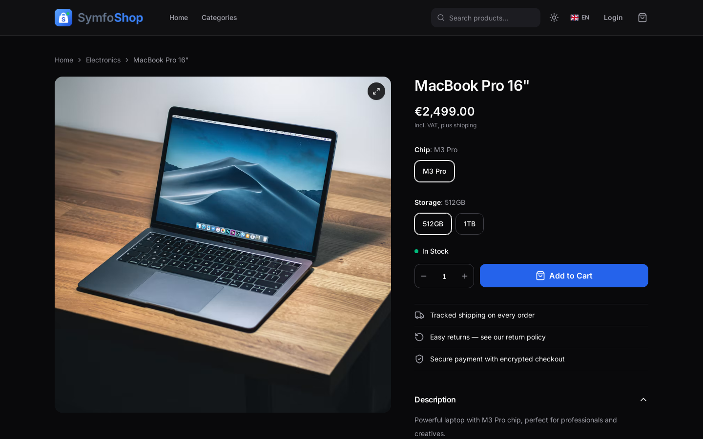<br><sub><b>Dark mode</b> – storefront …</sub></td>
    <td width="50%">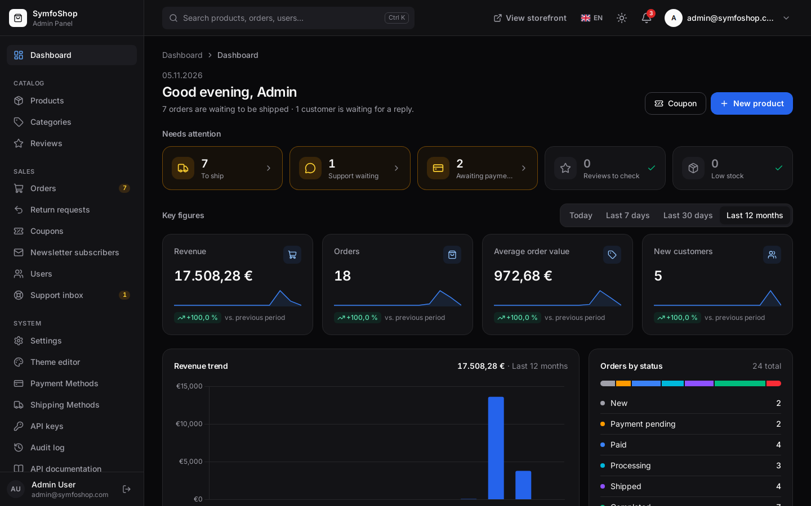<br><sub>… and back office</sub></td>
  </tr>
</table>

<table>
  <tr>
    <td width="33%" align="center">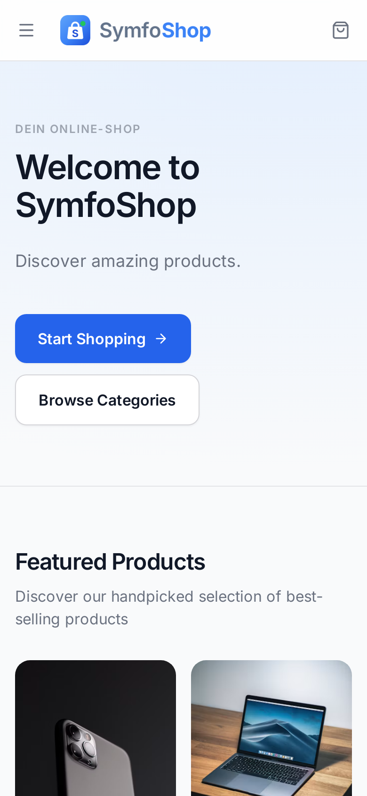<br><sub><b>Mobile storefront</b></sub></td>
    <td width="33%" align="center">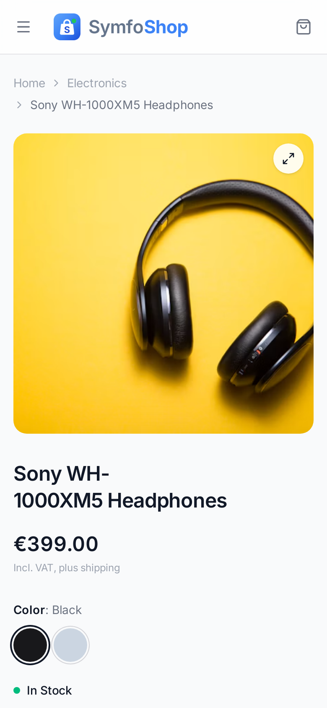<br><sub><b>Mobile product page</b></sub></td>
    <td width="33%" align="center">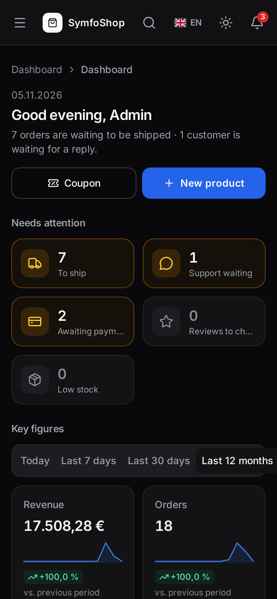<br><sub><b>Admin on mobile</b> – dark mode</sub></td>
  </tr>
</table>

## Features

### Storefront
- **Catalog** with categories, products, variants, stock status, media and search.
- **Cart** with coupons, **wishlist** (heart on a product → `/account/wishlist`) and back-in-stock notifications.
- **Legal & compliance**: legal pages, cookie banner, contact and return forms, sitemap and `robots.txt`.
- **Languages**: EN / DE / FR (switcher in the navbar), light and dark mode.

### Checkout & payments
- **Workflow-based orders** with shipping methods and **country-based VAT**.
- **Stripe** and **PayPal** (Orders API v2) with verified, idempotent webhooks; a **test bank** provider for demos and development.

### Customer account
- Register, login and password reset.
- Dashboard with profile, orders, **localized invoice PDFs**, wishlist and support conversations.

### Back office (`/admin`)
- Products, categories, reviews, orders, return requests, coupons, newsletter subscribers, users and the support inbox.
- Settings, theme editor, payment and shipping methods, API keys, audit log.
- **Roles** for admin, support and warehouse; admin sign-in with **two-factor authentication** (TOTP).

### API
- **REST API** with OpenAPI / Swagger UI at `/api/v1/docs`, authenticated with Bearer API keys.

## Tech stack

| Layer | Technology |
|-------|------------|
| Backend | PHP 8.2+, Symfony 7.4 LTS (Security, Forms, Workflow, Messenger, Rate Limiter), scheb/2fa |
| Persistence | Doctrine ORM + Migrations, MySQL/MariaDB or SQLite |
| Frontend | Twig, AssetMapper, Tailwind CSS 4 (standalone binary, no Node.js), Alpine.js, Symfony UX Icons (Lucide) |
| Integrations | Stripe SDK, PayPal Orders API v2, DomPDF, Nelmio API Doc, Sentry (optional) |
| Quality | PHPUnit, Playwright end-to-end tests, GitHub Actions |

## Quick start

### Requirements

- PHP 8.2+, Composer
- MySQL/MariaDB or SQLite
- Docker (optional) · Symfony CLI (optional)

### Docker

```bash
git clone https://github.com/JeremyT2002/SymfoShop.git && cd SymfoShop
make docker-up && make docker-db-setup && make docker-admin-user   # optional: make docker-load-fixture
```

→ [http://localhost:8000](http://localhost:8000) · Compose files in `docker/` (`compose.yaml`, `compose.override.yaml`, `Dockerfile`).

### Local (no Docker)

```bash
git clone https://github.com/JeremyT2002/SymfoShop.git && cd SymfoShop
composer install
cp .env.example .env    # then set APP_SECRET, DATABASE_URL, …
make db-seed            # database + migrations + fixtures
make admin-user
make assets             # builds the CSS (first run downloads the Tailwind CLI)
make dev
```

While working on templates, keep the CSS in sync with `make assets-watch` (`symfony serve` starts this watcher automatically via `.symfony.local.yaml`).

### Sample data & logins

```bash
make db-fixtures
```

Loads 5 categories and 9 products with variants, stock and media. Admin: **`admin@symfoshop.com`** / **`admin123`**.

### Configuration

Use **`.env`** for defaults and keep **secrets** in **`.env.local`** or the host environment – never commit live keys. Load order (later wins): `.env` → `.env.local` → `.env.<APP_ENV>` → `.env.<APP_ENV>.local`.

| Variable | Purpose |
|----------|---------|
| `APP_SECRET` | Random string, ≥ 32 characters |
| `DEFAULT_URI` | Base URL for CLI/routing (e.g. `http://localhost`) |
| `DATABASE_URL` | Database connection; SQLite by default in the template |
| `MAILER_DSN` / `MAILER_FROM` | Mail transport (e.g. `null://null` in dev) and sender address |
| `CONTACT_NOTIFY_EMAIL` | Inbox for the contact form (falls back to `MAILER_FROM`) |
| `MESSENGER_TRANSPORT_DSN` | Async transport (e.g. `doctrine://default`) |
| `PAYMENT_PROVIDER` | `dev`, `stripe`, `paypal`, … |
| `STRIPE_*` | `STRIPE_SECRET_KEY`, publishable key, `STRIPE_WEBHOOK_SECRET` |
| `PAYPAL_*` | `PAYPAL_CLIENT_ID`, `PAYPAL_CLIENT_SECRET`, `PAYPAL_WEBHOOK_ID`, optional `PAYPAL_BASE_URL` |
| `CHECKOUT_SKIP_PAYMENT` | Dev-only shortcut; use `0` in staging/production |
| `SENTRY_DSN` | Optional; used when `APP_ENV=prod` |
| `DEMO_MODE` | `1` only on a **public demo**: one-click sign-in buttons on the login page. Never enable it on a real shop. |

### Make commands

| Command | Description |
|---------|-------------|
| `make setup` / `make install` | Full local setup / Composer install |
| `make db-seed` | Database + migrations + fixtures |
| `make db-create` · `db-migrate` · `db-reset` · `db-fixtures` | Database lifecycle |
| `make dev` | Symfony dev server |
| `make assets` / `make assets-watch` | Build CSS and compile assets / rebuild on change |
| `make app-update` | Update from GitHub (fast-forward only) + migrations + cache |
| `make test` · `make lint` | Tests / linters |
| `make cache-clear` | Clear the cache |
| `make cleanup-reservations` · `make remind-abandoned-carts` | Maintenance jobs |

## Payments

**Stripe** (`POST /webhook/stripe`)
- Requires `STRIPE_WEBHOOK_SECRET`; otherwise the endpoint returns **503** (configure in [Stripe Dashboard → Webhooks](https://dashboard.stripe.com/webhooks)).
- Verifies `Stripe-Signature`; idempotency via `processed_webhook_event` (duplicate completed events → 200).

**PayPal** (`PAYMENT_PROVIDER=paypal`)
- Start in the sandbox with `PAYPAL_CLIENT_ID` and `PAYPAL_CLIENT_SECRET`; live base URL: `https://api-m.paypal.com`.
- Return / cancel: `GET /payment/paypal/return`, `GET /payment/paypal/cancel`.
- Webhooks: `POST /webhook/paypal` – set `PAYPAL_WEBHOOK_ID` from the PayPal developer app.
- Without credentials it behaves like the dev simulator (no real PayPal API calls).

## Testing

```bash
make test              # all tests
make test-unit
make test-integration
make test-coverage
```

End-to-end tests with Playwright live in `e2e/`.

**GitHub Actions** (push/PR to `main` and `dev`): Composer install, `lint:yaml`, `lint:translations`, `lint:twig`, `lint:container` (`test` env) and PHPUnit. The workflow creates a minimal `.env` (including `DEFAULT_URI`) so `cache:clear` after `composer install` succeeds.

## Deployment

SymfoShop runs on any server with PHP 8.2+, a web server and MySQL – or via Docker Compose. The public reference installation runs on Ubuntu 24.04 LTS with Apache, PHP 8.3 and MySQL 8, HTTPS via Let’s Encrypt.

**Production logging:** with `APP_ENV=prod`, Monolog writes **JSON to stderr** (`config/packages/monolog.yaml`) – suitable for containers. Payment payloads and tokens are never logged.

**Updates:** `make app-update` pulls the latest version (fast-forward only), runs migrations and refreshes the cache.

**Background jobs:**

```bash
php bin/console messenger:consume async          # keep a worker running (mails, reminders)
make cleanup-reservations                        # release expired stock reservations (e.g. every 5 minutes)
make remind-abandoned-carts                      # every hour
php bin/console app:security:cleanup-expired-reset-tokens
```

**Public demo** (`DEMO_MODE=1`): run `php bin/console app:demo:accounts` every few minutes so the demo accounts stay usable (roles, 2FA off), and reset the demo data regularly (e.g. restore a database snapshot every hour).

## Architecture

- **Layers:** domain logic in services, thin controllers, Doctrine entities and repositories.
- **Order states (Workflow):** `new` → `payment_pending` → `paid` → `processing` → `shipped` → `completed` (or `cancelled`).
- **Inventory:** `onHand` / `reserved`, expiring reservations, optimistic locking.
- **Frontend:** design tokens and component classes in `assets/styles/app.css` (theme-editor colors override the defaults at runtime); storefront entry `assets/app.js`, admin entry `assets/admin.js`; global form theme `templates/form/theme.html.twig`. New icons: use `ux_icon('lucide:name')` and run `php bin/console ux:icons:lock`.

### Security

Password hashing, CSRF protection on session forms, role hierarchy, two-factor authentication for the back office, login throttling and registration rate limiting, secure reset tokens, webhook signature checks and parameterized queries via Doctrine. The API is stateless and uses API keys.

### Project structure

```
SymfoShop/
├── assets/           CSS (Tailwind), JS modules, fonts, icons
├── config/           Symfony configuration
├── docker/           Docker Compose & Dockerfile
├── docs/             Logo and screenshots
├── e2e/              Playwright end-to-end tests
├── migrations/
├── public/           Web root
├── src/
│   ├── Command/
│   ├── Controller/
│   ├── Entity/
│   ├── Repository/
│   ├── Service/
│   └── Workflow/
├── templates/
├── tests/
└── translations/
```

## Troubleshooting

```bash
make db-reset
make cache-clear
make assets            # unstyled pages? the CSS has not been built yet
php bin/console doctrine:migrations:status
php bin/console doctrine:migrations:sync-metadata-storage
```

## Contributing

1. Follow PSR-12, typed properties/parameters and “fat services, thin controllers”.
2. Add tests for new behavior and run `make test` before larger changes.
3. Keep commits small with clear messages; open a PR from a feature branch (e.g. `gh pr create`).
4. Update this README when setup, environment variables or APIs change.

Shared agent rules live under `.cursor/rules/`.

## License

Proprietary.
